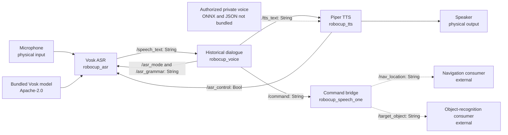

# RoboCup @Home Voice 2026

**Galu Robotics portfolio · Author: Hiram Rafael Pérez Ibarra**

A ROS 2 voice subsystem connecting offline **Vosk speech recognition**, historical
keyword dialogue, **Piper text-to-speech**, and navigation/object-recognition
integration through ROS topics. This repository reconstructs the April 2026
implementation as an independent five-package workspace.

**Owner-reported national 2026 result: 10 points + 1 extra (11 total).**
This is the reported team result associated with the project, not a score claimed
for the voice module alone. An official score sheet and the exact deployed
checkout have not been independently verified. [Result evidence](docs/COMPETITION_2026.md).

**License:** MIT applies to Hiram's original code in the five ROS 2 packages.
Third-party terms remain separate. Piper voice weights/configuration are omitted.
No repository has been published by this preparation.

## Engineering scope

- Five `ament_python` packages with separate recognition, synthesis, dialogue,
  integration and launch responsibilities.
- Offline Vosk model, configurable command/confirmation grammars, noise calibration
  and TTS-driven pause/resume control.
- Historical keyword parser and confirmation state machine using April objects
  and locations; explicit provenance and differential regression tests.
- A bridge from `/command` to `/nav_location` and `/target_object` for external
  navigation and object-recognition consumers.
- Portable installed model/configuration paths and a reproducible simulated demo.

The bridge publishes location names; it does not plan a path or execute a Nav2
goal. Navigation consumers, maps, perception, manipulation and robot hardware
are outside this repository. No international-2027 functionality is included.

## Architecture

The diagram describes implemented code connections, **not hardware validation**.
Dashed consumers are external, and a private authorized Piper voice is required
for real synthesis/playback.



`robocup_bringup` starts the four nodes through one launch file.

| Package | Executable | Responsibility |
| --- | --- | --- |
| `robocup_asr` | `vosk_asr_node` | Mono 16 kHz PCM capture, energy filtering, Vosk recognition and grammar/listen control |
| `robocup_tts` | `tts_node` | Piper synthesis/playback and ASR pause/resume |
| `robocup_voice` | `voice_node` | Wake words, keyword parsing, confirmation, rejection and historical timeout |
| `robocup_speech_one` | `speech_one` | Parse the command dictionary and publish object/location names |
| `robocup_bringup` | `robot_launch.py` | Launch orchestration; optional `audio:=false` text-only mode |

Topics use `std_msgs/msg/String`, except `/asr_control` (`std_msgs/msg/Bool`).
Queue depth remains 10. `/command` is a Python dictionary string, **not JSON**:
`{'object': 'milk', 'location': 'bed'}`. The bridge uses `ast.literal_eval`.

## Try the simulated demo — no ROS or hardware

Use Python 3.12 from the repository root:

```bash
python3.12 -m venv .venv
source .venv/bin/activate
python -m pip install -r requirements-demo.txt
python scripts/demo_simulated.py
```

The command reuses the existing four-node fixture, checks its assertions and
prints the topic trace actually recorded by the test. It uses **ROS/Vosk/Piper
test doubles and synthetic PCM**; it opens no microphone or speaker and uses no
DDS. It is an engineering demonstration of the control flow, not speech accuracy.

Fixture input: `ava` → `milk bed` → `confirm`. Selected observed output:

```json
{
  "mode": "simulated",
  "ROS_DDS": false,
  "physical_audio": false,
  "recognition_and_synthesis": "test doubles",
  "observed_topics": {
    "/speech_text": ["ava", "milk bed", "yes"],
    "/command": ["{'object': 'milk', 'location': 'bed'}"],
    "/target_object": ["milk"],
    "/nav_location": ["bed"]
  },
  "final_dialogue_state": "idle"
}
```

The simulated ASR maps the confirmation fixture `confirm` to `yes` before Voice
receives it. [Complete captured trace](docs/demo-output.json).
A CLI regression test checks the demo from a different working directory.

## Historical implementation vs reconstruction

Source snapshot: `9952f30a2775cede3d69c0dc34962ff609addead`, April 16, 2026.
The exact imported text is preserved in `reference/snapshot/`, excluded from
colcon with `reference/COLCON_IGNORE`. It is evidence, not a second runnable
workspace. The original Git history was not copied.

| Layer | What is retained or changed |
| --- | --- |
| Historical | Vosk/Piper flow, dictionary, parser, topics, separate bridge outputs, rejection without a new wake word |
| Portability | Complete package declarations, pinned reconstruction dependencies, installed resource lookup, model-path parameters and optional text-only launch |
| F01 correction | Reject nonstring object/location fields instead of crashing the bridge |
| F02 correction | Use the supplied Piper voice's sample rate instead of always 22,050 Hz |
| Portfolio preparation | Documentation, explicit author/result evidence, Mermaid diagram and a fixture-based demo; no active node changes |

**Known legacy behavior:** more than 15 seconds without confirmation automatically
publishes the command. Silence is not explicit consent. The historical ASR drops
literal recognized `yes` in confirmation mode; spoken `confirm`, `correct` or
`affirmative` are mapped to `yes`. Direct `/speech_text` injection of `yes`
bypasses that gap. These behaviors are preserved and tested, not silently fixed.

April configuration: objects `coke`, `milk`, `noodle`, `yogurt`; locations `bed`,
`table`, `shelf`, `counter`. [Changes and limitations](docs/CHANGES.md).

## What has actually been verified

[Verification evidence](docs/VALIDATION.md) separates local packaging, simulation,
real-engine checks and pending runtime/hardware work. The competition result is
separate owner-reported evidence; it does not certify these checks.

| Verification level | Scope/status |
| --- | --- |
| Python/colcon packaging | Five packages build and install on Python 3.12 without a ROS underlay |
| Simulated behavior | Historical comparisons, parser/confirmation/timeout, ASR/TTS control, bridge, malformed inputs and full fixture flow; see current counts in the evidence report |
| Installed assets | Five resource markers, four entry points, YAML, launch and verified model/notice bytes |
| Real Vosk | Model load and one second of synthetic silence; no spoken accuracy claim |
| Real Piper | Import/chunk API verified; voice loading, synthesis and playback remain unverified |
| Real ROS 2 / DDS | Pending; host ROS is absent and Docker socket access is denied |
| Physical robot | Microphone, speaker, echo, noise/distance and navigation consumer behavior remain unverified |

No continuous CI badge or fully tested robot claim is presented.

## ROS 2 setup and real voice operation

Reconstruction target: **Ubuntu 24.04 / Python 3.12 / ROS 2 Jazzy**. The competition
ROS distro and installed versions remain unknown. Pins are reconstruction choices;
Piper `1.4.2` is not asserted to be the competition dependency version.

See [setup commands](docs/SETUP.md) for native ROS, Docker, text-only DDS operation
and an authorized private Piper model. Run `bash scripts/verify.sh` after sourcing
Jazzy and the dependency environment. See the [physical checklist](docs/PHYSICAL_CHECKLIST.md)
for checks that cannot be replaced by simulation or model enumeration.

## Author, licensing and model provenance

**Hiram Rafael Pérez Ibarra** developed all project-owned code in the five voice
packages, as explicitly confirmed by the author. [Authorship](AUTHORS.md).
Galu Robotics is the requested portfolio presentation, not a new claim of
ownership over third-party code/models.

**MIT applies to that own code.** Package manifests declare MIT, with the ASR
package also declaring Apache-2.0 for its bundled Vosk model. See [license scope](LICENSE.md)
and [adoption record](docs/LICENSING.md).

- Vosk API and bundled `vosk-model-small-en-us-0.15`: Apache-2.0. The model's 14
  original files were verified against the official ZIP; LICENSE/NOTICE are installed.
- Piper `1.4.2` runtime: GPL-3.0-or-later. MIT for original project code does not
  remove Piper or native-component obligations for a combined runtime/container.
- Lessac `en_US-lessac-medium` ONNX and JSON: omitted because redistribution
  permission has not been established. No automatic voice download or substitute.
- OSRF template references: original Apache-2.0 headers retained.

[Third-party notices](THIRD_PARTY_NOTICES.md) · [Provenance](docs/PROVENANCE.md) ·
[License scope](LICENSE.md). Do not present every file or a combined runtime as MIT-only.

## Review map

- `src/`: five adapted packages; no later HRI/2027 package.
- `reference/snapshot/`: immutable historical text and its attribution.
- `tests/` and `scripts/`: repeatable simulated/demo, installation and runtime checks.
- `docs/`: evidence, changes, competition statement, license scope and draft
  [GitHub metadata](docs/GITHUB_PRESENTATION.md).
- `FILE_MANIFEST.json`: current candidate-source inventory, excluding local builds,
  caches, private settings/models, recordings and validation artifacts.

[Publication readiness and blocking items](docs/PUBLICATION_READINESS.md).
